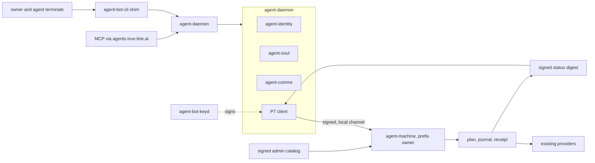
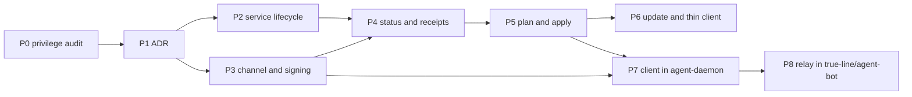

# Machine daemon (agent-machine)

## Intent

Owner direction (2026-10-29): turn managed-machine into a privileged daemon.
Commands can be run against it to install predetermined software, and it
reports status updates about the machine. Carry over as much of the existing
managed-machine and managed-machine-config code as possible. Model it on the
agent-bot daemon work (agent-bot-identity, 0.15.x).

The machines are developer machines. The owner approves software by publishing
it in the signed admin catalog; nothing else is approval and nothing else is
installable.

**Names (owner, 2026-10-29).** agent-daemon is the local control plane. It
owns agent-identity, agent-soul, and agent-comms. Terminals and agents talk
only to agent-daemon, through the agent-bot-cli shim. agent-machine is a
separate daemon: a secure executor and nothing else. This repository,
managed-machine, is renamed to agent-machine. The rename is specified here
and is not performed until this plan is reviewed. P7 is the client inside
agent-daemon. agent-machine is not a fourth component beside identity, soul,
and comms.

## Decisions (owner, 2026-10-29)

1. **Platforms.** macOS, Linux and Windows are all in scope from the first
   slice. OS-specific code is confined to the service manager, the local
   channel and peer identity, behind build-tagged files (as
   `internal/plan/lock_unix.go` and `lock_windows.go` already do).
2. **Least privilege.** "Privileged" means the account that owns the
   package-manager prefixes, on macOS the `admin` user that owns Homebrew.
   The daemon never runs as root or SYSTEM, and never uses `su`, `setuid`,
   `sudo`, a sudoers rule, a root helper, or UAC. A catalog row whose
   published install needs elevation (a `.pkg` cask, a cask postflight that
   writes outside the prefix, system settings, `/Library`, or machine-scope
   writes) is refused with `MM_DAEMON_PRIVILEGE_REQUIRED` and left as a human
   action. It is not installed through a narrowed sudoers rule or a root helper.
3. **No approval gates on verbs.** Publishing an entry in the signed admin
   catalog is the owner's approval. No pinned entry may need approval or
   elevation at install time. Installing and uninstalling the service itself
   remains a human action from the owner's account; agent accounts are refused.
4. **One client.** Only agent-daemon, on the same machine, talks to
   agent-machine. The caller inside agent-daemon is the P7 client. Remote
   requests are MCP calls through agents.true-line.ai, relayed to that
   machine's agent-daemon. Local agents also go through agent-daemon, via
   agent-bot-cli.
5. **Agents may install** pinned catalog items, not only read status. The
   control plane publishes the admin catalog, signed. agent-machine installs
   only pinned items from that catalog. A local edit of `apps.json` is not
   an install.
6. **`update` replaces `managed-machine --update`.** The Terminal command
   becomes a thin, separately paired client of the daemon, for machines where
   the agent-bot runtime is not installed or not wanted. The legacy path
   remains only as the fallback when the daemon itself is absent.
7. **Status** is readable by anything through agent-bot. The daemon publishes
   a signed digest after every receipt and every 15 minutes.
8. **No dynamic input.** Nothing a caller sends is processed as privileged
   input. A request may only select among options the catalog declares (for
   example a declared version `10.6` of a row that declares `10.5` and
   `10.6`). An undeclared version, or any URL, path, package name, flag or
   script, is refused before anything runs.
9. **Mutual key registration and signed requests.** The two daemons register
   keys with each other and sign their requests, so an impostor is refused even
   when it runs under an allowed account. Keys are held and registered through
   existing agent-bot infrastructure (agent-bot-keyd and/or
   agents.true-line.ai).

## Target

### Carried over unchanged

| Piece | Where | Role in the daemon |
|---|---|---|
| Catalog | `internal/catalog`, `internal/definition`, `internal/schema`; today's `apps.json` is the local source the control plane signs | Only pinned items from the signed admin catalog |
| Providers | `internal/provider/*` | The install engine; host allowlists, sha256, Team ID and no-elevation rules stay |
| Plan, journal, receipt | `internal/plan` (ADR-0012), `internal/execute`, `internal/statedir` | Every state change is plan, then apply by plan ID, then receipt |
| Status | `internal/status` | The status body |
| Diagnostics | `internal/diag` | `MM_DAEMON_*` codes in responses |
| Output contract | `internal/output` | Response encoding |
| Extension protocol | `internal/protocol` (`mm-extension-1`) | Template for the bounded one-JSON-line wire format |
| Config apply | `internal/config` Go providers (files, blocks, structured config, templates) | Settings after install. `config/<name>` scripts are not run |
| Fleet identity | `internal/fleet`, `machine.toml` | Identity the daemon reports under |

### Closed verb set

- `status`: machine, software, config, flavor and fleet sections and the last
  receipts. Read-only.
- `receipts`: list and read receipts.
- `plan software <catalog-name> [--option <declared>] --<declared target>` and
  `plan config`.
- `apply <plan-id>`: only a saved plan ID (ADR-0012).
- `update`: re-run the declared flavor.
- `catalog`: accept a signed catalog envelope from the paired agent-daemon.

Anything else is refused with `MM_DAEMON_VERB_UNKNOWN` or
`MM_DAEMON_NOT_IN_CATALOG`. There is no command-execution verb and no SSH
verb. Requests carry identifiers only; the daemon resolves them against the
catalog it loaded itself from the signed admin catalog, and fails closed
on anything unknown, including extra fields. The signature is checked before
a name exists.

### Per-OS shape (proposed; confirmed in P1)

| | macOS | Linux | Windows |
|---|---|---|---|
| Service | per-user LaunchAgent of the prefix owner. A system LaunchDaemon needs root, which this daemon does not have | systemd user unit, `NoNewPrivileges=yes`, `ProtectSystem=strict`, `PrivateTmp=yes`. `ReadWritePaths` names only the Linuxbrew prefix, `~/.local` (npm and uv prefixes), `~/.cache`, `~/.npm` and `~/.config/agent-machine`; install creates the home-relative ones. A system unit needs root | service description written for the developer account and not registered. Registering a Windows service needs an elevation this daemon does not have |
| Channel | Unix socket, directory `0700` | Unix socket, directory `0700` | Named pipe, DACL for that account only |
| Peer identity | `getpeereid` | `SO_PEERCRED` | named-pipe client process token SID, which must match the daemon process |
| Scope | Homebrew prefix, `/Applications` (admin group) | Homebrew/Linuxbrew or user prefixes | winget user scope, user prefixes |

Peer identity is checked first and is never sufficient alone; every request
must also carry a valid signature from a registered key.

### Pairing and signing

- Each side holds its own Ed25519 keypair; private keys never leave their
  holder (agent-bot's side is held by agent-bot-keyd). The two exchange public
  keys; there is no shared secret.
- Each request is signed over the verb, its catalog identifiers, the
  originating soul and harness, a timestamp and a single-use nonce. The daemon
  refuses a bad signature, an unknown key, a stale timestamp and a replayed
  nonce.
- Every response and status digest is signed by the daemon. A response
  includes `request_nonce`, the nonce of the request it answers, inside the
  signed payload. A status digest is not a request response, so its
  `request_nonce` is empty. A client accepts a response only when that field
  is the nonce it just sent and `daemon.pub` verifies the signature.
- Re-registration stages the new key and keeps that client's live pairing
  until the new one is confirmed (agent-bot #1243). Either side can revoke
  one client by writing `peers/<client>.revoked`. The daemon reads the pairing
  files before each request, so that file drops that client's live key without
  a restart. The other client stays live. A confirmed replacement is accepted
  on the next request. There is no revoke verb.
- Two clients, `terminal` and `agent-daemon`. Each has `peers/<client>.pub`
  and its own `.next`, `.confirm`, and `.revoked`. The gate accepts either
  live key. `peer.confirm` stays the SHA-256 of that client's staged key.
  An existing `peer.pub`, `peer.next`, `peer.confirm`, or `peer.revoked` is
  moved to `peers/terminal.*` on startup. If those old files and `peers/` are
  both present, the daemon does not listen. A stray file in `peers/`, such as
  `.DS_Store`, refuses startup and the next request with
  `MM_DAEMON_UNKNOWN_KEY` and the file name. If a move stops halfway, move
  `peers/terminal.*` back to `peer.*`, remove `peers/` only when it holds no
  other client, and start again. A later client is not added by dropping a
  file in `peers/`.

### Execution environment

- Every child process gets an explicit minimal environment: the account's
  `HOME`/`USERPROFILE`, a fixed `PATH`, and no inherited `HOMEBREW_*`,
  `npm_config_*` or `UV_*` variables. Arguments come only from the catalog;
  no shell is involved.
- Socket or pipe and state directory are owned by the daemon account
  (`0700`/`0600`).
- Receipts record the account an operation ran as and who asked (soul, agent,
  harness, or the Terminal client) and a nullable `session_id`. Receipts, digests and manifests never hold
  command output or secrets.

### Catalog trust

The signing key does not live next to the catalog. `catalog.pub`,
`catalog.pub.pin`, and `catalog.version` are writable by the same account that
writes `catalog.json`, so the daemon does not pin a key from those files and
does not record a version floor there. The key has to arrive from the paired
channel. Until it does, a present `catalog.json` is an error and `Run` does
not listen. Missing `catalog.json` is an empty catalog. A catalog whose
`version` is missing or below 1 is refused. The daemon never writes
`catalog.pub.pin` or `catalog.version`.

### Constraints kept

Casks only into `/Applications` with tap, sha256, vendor host and Team ID
verified; codesign/notarization checks never skipped; Homebrew prefix stays
`admin`-owned and brew never runs as root; SSH enrollment stays human-only; no
config-repo content, machine or key records as fixtures; two-step release
flow; ENG-0339 identity rules.

### AGENTS.md changes (land in P2)

- The daemon runs as the prefix owner, never elevated, on all three OSes; the
  providers keep "never elevate".
- Agent accounts may install from the agent-machine catalog through the
  daemon; this is how today's "`--update` refuses agent sessions" maps onto
  daemon verbs.
- Adding a catalog entry is the approval; no entry may need elevation.
- `--update` is a thin daemon client with a legacy fallback.

## Phases

Every managed-machine phase passes `gofmt -l . && go vet ./... && go test
./...` on macOS, Linux and Windows, and `tests/machine-daemon.test.sh`, using
synthetic catalog fixtures only and no real installs.

### P0: privilege audit (managed-machine-config, managed-machine)

On a real macOS, Linux and Windows machine, classify every catalog row as
installable by the prefix owner without elevation, or needing elevation.

Acceptance: a checked per-OS table recorded in the P1 ADR; rows needing
elevation are excluded from the agent-machine catalog (mechanism decided in
P1) and unreachable through the daemon.

#### macOS check (2026-10-29, this machine)

Catalog is `managed-machine-config` `apps.json` schema 1, 52 rows. Homebrew
prefix `/opt/homebrew` is `admin:admin` mode `0755`. `/Applications` is
`root:admin` mode `0775`, so the `admin` group can write it. `/usr/local/bin`
is `root:wheel` mode `0755`. The session account `user` is not in the `admin`
group and can write neither `/Applications` nor the prefix. The `admin`
account is uid 501 and is in the `admin` group. The daemon runs as `admin`.

Cask artifacts were read from the Homebrew API (`formulae.brew.sh`), not by
installing. No catalog cask has a `pkg` artifact.

| Result | Rows |
|---|---|
| Installs as `admin` with no elevation | 20 `signed-cask` rows whose artifacts are `app` / `binary` / `zap` / `uninstall`: warp, opencode-app, lmstudio, vscode, vscode-insiders, cursor, grokbot, claude-app, chatgpt-app, devin-app, antigravity-app, antigravity-ide, kiro, kiro-cli, zcode, brave, chrome, discord, slack, telegram. Both `vendor-dmg` rows: muse-app, qwen-desktop. All 7 `brew-formula` rows: qwen, minikube, taplo, ripgrep, fd, ast-grep, uv. All 6 `npm` rows: commandcode, copilot, cline, pi, deepseek, mcode. The `uv-tool` row: mistral-vibe. |
| Needs elevation, refused, left as a human action | `docker` (`signed-cask` token `docker-desktop`). The app copy does not, but the published cask postflight symlinks `kubectl` into `/usr/local/bin` with `sudo` if needed, and that directory is not writable by `admin`. Owner decision (2026-10-29): do not add a sudoers rule or a root helper. The daemon refuses the row. A person installs it outside the daemon. |
| Not offered, because the install is a remote shell script | 13 `official-cli` rows (proton-pass, muse, claude, codex, antigravity, grok-build, amp, aider, roocode, kilocode, droid, goose, hermes), plus `opencode` and `devin`. managed-machine runs these as `curl \| bash`. The daemon does not execute scripts. |

`config/<name>` (aider, claude, codex, commandcode, grok-build, grokbot, kilocode, muse, muse-app, opencode, roocode, zsh) are scripts too. The daemon applies config only through the Go config providers.

Linux and Windows were not checked on a real machine. This catalog has no winget rows. `signed-cask` and `vendor-dmg` are macOS-only.

### P1: ADR (managed-machine-documentation)

Acceptance: an ADR covering the per-OS privilege model (prefix owner, never
root; "privileged" means that account), the decision that rows needing
elevation are refused and left as a human action, the client and pairing
model (terminal and agent-daemon, each with its own pairing), the closed
verb set, no dynamic input, no approval
gates, the signed admin catalog, the `MM_DAEMON_*` diagnostics, the wire
format (bounded JSON lines modelled on `mm-extension-1`), and the P0 table.

### P2: service lifecycle (managed-machine)

`managed-machine daemon run|install|uninstall|status|pair|unpair` writes a per-user
service unit: a LaunchAgent, a systemd user unit, or a Windows service
description that is not registered, and `pair`/`unpair` manage the Terminal
`--update` client key (`client.key` and `peers/terminal.*`). A system service
manager needs root, which this daemon does not have.

Acceptance: install and uninstall are idempotent, run from the owner's account,
and refuse agent accounts, root/SYSTEM, foreign-HOME callers, and a caller
that does not own the shared prefix when that prefix exists; the AGENTS.md
changes above land; `.github/workflows/go-core.yml` runs on all three OSes.
On Linux, a brew, an npm and a uv row each install from inside the unit's
sandbox: with only `~/.local` and the state directory writable, brew refused
the read-only prefix, npm failed with EROFS on `~/.npm`, and uv could not take
its lock in `~/.cache`.

### P3: local channel and signing (managed-machine)

Unix socket (macOS, Linux) and named pipe (Windows), peer identity, Ed25519
pairing, nonce and timestamp checks, signed responses, staged re-registration,
revocation.

Acceptance tests: a correctly signed request from the registered key is
accepted; refused are an unsigned request, an unknown key, a tampered request,
a stale timestamp, a replayed nonce, and an unregistered process under the same
account; re-registration keeps the old key until the new one is confirmed;
writing `peers/<client>.revoked` while the daemon is running refuses the
next request from that key, the other client stays live, and a confirmed
replacement is accepted without a restart.

### P4: status and receipts (managed-machine)

Acceptance: `status` and `receipts` served from `internal/status` and the
receipts; each receipt row and receipt status record includes the catalog
software `name` (`doc.Software`) so `agent-daemon` can join installed state
by catalog item name; a signed digest after each receipt and every 15
minutes; digests contain no command output and no secrets.

### P5: plan and apply (managed-machine)

One catalog item through the existing providers, as the prefix owner.

Acceptance tests: the child's account, home and environment are the expected
ones on each OS; a declared option is accepted; an undeclared version, a URL, a
path, an extra field, an unknown catalog name and a row needing elevation are
refused before any process starts; the receipt is written and status reflects
it. A present `catalog.json` is refused until the signing key arrives from
the paired channel. The daemon does not pin `catalog.pub` and does not write
`catalog.pub.pin` or `catalog.version`. A missing version or a version below
1 is refused. Deleting a pin or a version record does not make a disk catalog
acceptable. Missing `catalog.json` is an empty catalog. A brew row carries
its formula token. Apply passes that token to the brew provider. An npm row
carries a package token and a uv row carries a tool token. Apply passes that
token and does not pass the request option. A brew cask row carries its
cask token, app name, Team ID, url hosts, and homepage hosts. An app-copy
(`vendor-dmg`) row carries its url, sha256, url hosts, app name, Team ID,
version, and format. A winget row carries its `package_id` and never runs
elevated, so machine scope (`global`) is refused with
`MM_DAEMON_PRIVILEGE_REQUIRED`. A go row carries its `module` and `package`,
a cargo row carries its `crate`, and an archive row carries its `url`,
`sha256`, `url_hosts`, `version`, `format`, and `files`. Apply runs and
verifies each planned operation in order. A token on
the wrong provider, a row with more than one recipe, a cask, app-copy, or
archive recipe missing one of those fields, or a brew, npm, uv, winget, go,
cargo, app-copy, or archive row without its recipe is refused before a
process starts. npm and uv are used only when that
executable is on the daemon's fixed PATH. The daemon does not install them.

### P6: update and the Terminal thin client (managed-machine)

Acceptance: the `update` verb re-runs the declared flavor; `managed-machine
--update` is a paired thin client of the daemon and falls back to the legacy
path when no daemon is installed; each request uses a fresh nonce and sets
harness to `terminal` so the receipt names the Terminal client; the client
accepts the response only when `daemon.pub` verifies it; on Windows the client
dials the named pipe; the `legacy/scripts/update` re-exec rule is preserved.

### P7: client inside agent-daemon (agent-bot-identity)

The client only. agent-machine stays the executor in its own repository.

Acceptance: agent-daemon routes and MCP tools that forward the closed verbs
over the signed local channel, pairing through agent-bot-keyd, and receipts
on the agent-daemon side. No installer and no catalog executor in this phase.

### P8: hosted relay and key attestation (true-line/agent-bot, Grok)

Acceptance: MCP requests to agents.true-line.ai are relayed to the machine's
agent-daemon, which forwards them to agent-machine; both daemon keys are
attested against the enrolled device, and the pairing is visible and
revocable on `/devices/manage`. Filed as true-line/agent-bot#66.
qwts/agent-bot-identity#1256 is closed. The catalog signing key is not pinned
from disk. It has to arrive on this pairing, and a present `catalog.json`
stays refused until that key is here. true-line/agent-bot#71 is the delivery
shape: `catalog_key`, `floor`, and `envelope` (`agent-bot-catalog/1`),
checked by `AcceptCatalog`. The check covers the key id, the signature, the
per-key floor, and a version strictly newer than the last one this process
applied for that key. `ReceiveCatalog` treats a null envelope, with a catalog
key and a matching floor, as nothing published under that key. It writes
nothing under `peers/` and no version file.
The `catalog` verb carries those three fields inside the signed request.
A null envelope leaves the in-memory catalog in place. A verified envelope
replaces it. The last accepted version for a key id is remembered in this
process only. The terminal pairing key cannot send the verb. Unknown fields
stay refused. A present `catalog.json` stays refused.

### Later

- A standalone `managed-machine-cli` client with its own pairing.

## Still open

- Key registration through agent-bot-keyd, agents.true-line.ai, or both, and
  which is authoritative. Proposed: keyd in P3/P7, server attestation added in
  P8.
- Windows service account: the shipped unit is per-user. The Windows service
  XML is written and not registered, because registration needs elevation.
- Linux prefix owner when Homebrew is absent. Closed: there is no prefix
  to adopt. A brew row whose canonical prefix has no `brew` binary is refused
  with `MM_DAEMON_PROVIDER_MISSING` before any process. The daemon does not
  install Homebrew and does not create the prefix. Windows has no canonical
  Homebrew prefix and gets the same refusal.
- When the managed-machine GitHub repository is renamed to agent-machine.
  Specified, not performed, until this plan is reviewed. `Formula/managed-machine.rb`
  installs `bin/agent-machine` as a symlink to `bin/managed-machine` so both
  CLI names work during the transition.
- The `catalog` verb is on the request. `catalog_key`, `floor`, and
  `envelope` are signed with the rest of the request and accepted only from
  the paired agent-daemon. The accepted catalog stays in memory.

## Replay

Open this plan plus `AGENTS.md`, `docs/go-core.md` and
`docs/plans/README.md`. Sources: managed-machine-config `AGENTS.md`;
managed-machine-documentation v1 spec, output and diagnostics contract, and
ADR-0012, ADR-0014, ADR-0016, ADR-0017; agent-bot-identity `agent-daemon.mjs`,
`docs/daemon-api.md`, `docs/server-mode.md`, `identity/server-client.mjs`,
`identity/relay-events.mjs`, `owner-approval.mjs` and agent-bot-keyd. Each
phase has a GitHub issue linked in `related_issues`; update the phase here when
its acceptance changes.
